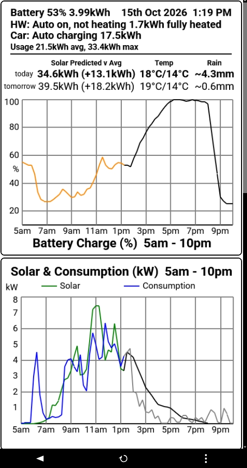
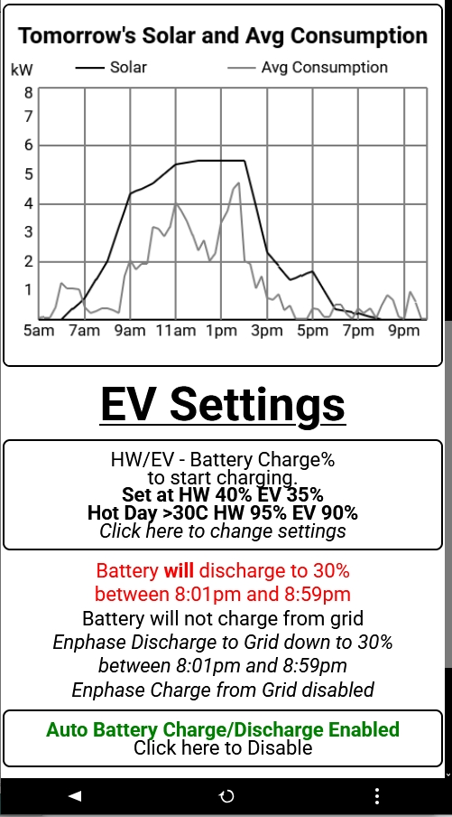

# Solar/Battery/EV/HW Forecast, Monitoring and Control with an ESP32

### Almost Off-Grid in the suburbs

|  |  |
|:---:|:---:|

An ESP32 (FireBeetle 2 ESP32-E) that forecasts, monitors and controls three
existing home power systems as one: an Enphase solar array + battery, a
solar-charged hot water tank, and a Hyundai Inster EV charger/V2H (vehicle-to-home)
controller. Each system keeps its own independent control and can override the
ESP32 at any time.

The ESP32 downloads forecast solar irradiance from [Open-Meteo](https://open-meteo.com/),
adjusts it for local tree/hill shading, and combines it with the 5-day average
consumption to forecast today's and tomorrow's Enphase battery state of charge.
That forecast drives EV and hot-water charging priority and when (if ever) to
discharge the battery back to the grid.

**Aim:** minimise grid dependence — ideally zero grid draw from 2pm–8pm (when
demand charges apply), no exporting surplus solar except a small window
8pm–9pm, and EV charging prioritised over hot water.

The code (ESP32 firmware, forecasting/control logic, and the Python shading-model
tooling) was written with Claude Code, including the display UI itself.

## Display

The UI client is [**pfodWeb**](https://www.forward.com.au/pfod/pfodWeb/index.html), a general purpose client for pfodDevices — runs
in any browser (PC, Mac, Linux, Android, iPhone), connects to the ESP32 over
HTTP, Serial, BLE or TCP, and needs no app install. The ESP32 serves `pfodWeb.html`
directly, so just browse to its IP address.

## Docs

Design/implementation notes under [`BatterySolarMonitorUpdate/docs/`](BatterySolarMonitorUpdate/docs/):

- [`esp32_control_structure.md`](BatterySolarMonitorUpdate/docs/esp32_control_structure.md) — how the `BatterySolarMonitor` firmware is structured; a function-by-function reference.
- [`solar_shading_model.md`](BatterySolarMonitorUpdate/docs/solar_shading_model.md) — how the Open-Meteo irradiance forecast is adjusted for this site's tree/hill shading, per sun position.
- [`solar_shading_stats.md`](BatterySolarMonitorUpdate/docs/solar_shading_stats.md) — the back-solved per-angle shade factors behind that model (1200+ days of Enphase production vs. Open-Meteo GTI).
- [`quarterly_update_process.md`](BatterySolarMonitorUpdate/docs/quarterly_update_process.md) — the process (`quarterly_update.py`) for refreshing the shading model from the latest historical data every 3 months.
- [`data_sources.md`](BatterySolarMonitorUpdate/docs/data_sources.md) — external APIs the `py_programs/` scripts depend on (Enphase IQ Gateway, hot water controller, EV charger).

## Adapting this to your own site

See **"Modifying this Project for Your Site"** in [`index.html`](https://www.forward.com.au/pfod/pfodWeb/index.html) for the
full walkthrough (site settings, removing controls you don't have, wiring up your
own data sources, regenerating the shading model, and editing the display menu via
pfodWeb's Designer) — the short version is: update `BatterySolarMonitorUpdate/site_settings.csv`,
then point an AI coding assistant at the docs above plus your own data-source
details and let it do the rest, one step at a time.

---

[`index.html`](https://www.forward.com.au/pfod/pfodWeb/index.html) is the full project write-up (parts list, construction,
detailed behaviour, Project Aims). pfodDevice™ and pfodApp™ are trademarks of
Forward Computing and Control Pty. Ltd.
